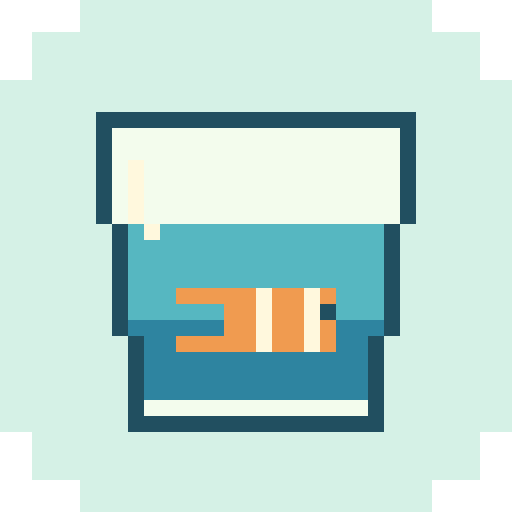
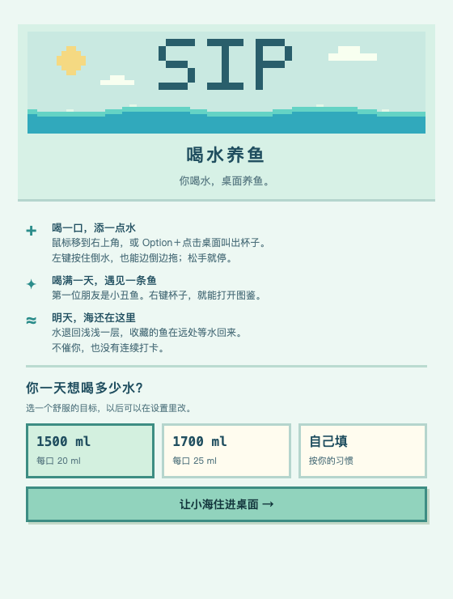
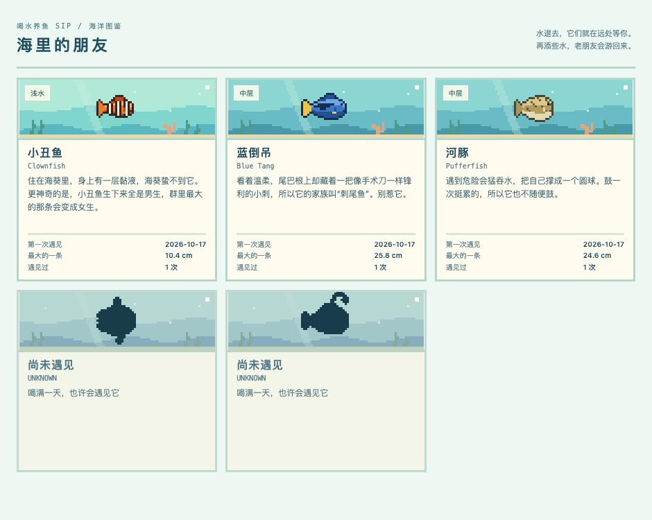

<p align="center">
  
</p>

<h1 align="center">喝水养鱼 · SIP</h1>

<p align="center"><strong>你喝水，桌面养鱼。</strong></p>
<p align="center">给桌面添一点水，也给自己留一小片海。<br>每天喝满自己设定的目标，遇见一条新的鱼。</p>

<p align="center">
  <strong>macOS 13+ · Apple Silicon · v0.1.1 试用版</strong>
</p>

<p align="center">
  <a href="https://github.com/hexiaodou122/SIP/releases/download/v0.1.1/Sip-0.1.1-mac-arm64.dmg"><strong>⬇ 下载 Mac 安装包</strong></a>
  &nbsp; · &nbsp;
  <a href="#agent-install"><strong>🤖 复制给 Agent 安装</strong></a>
  &nbsp; · &nbsp;
  <a href="https://github.com/hexiaodou122/SIP/releases/tag/v0.1.1">更新说明</a>
</p>

---

## ⬇ 把小海带回桌面

### 自己安装

**[下载 SIP v0.1.1（DMG，约 135 MB）](https://github.com/hexiaodou122/SIP/releases/download/v0.1.1/Sip-0.1.1-mac-arm64.dmg)**

1. 打开下载的 DMG，将「喝水养鱼」拖到 **Applications（应用程序）**。
2. 在应用程序里打开「喝水养鱼」，选择每天想喝的水量。
3. 鼠标移到屏幕右上角，叫出杯子，开始添水。

适用于 **M 系列 Mac、macOS 13 或更新系统**，暂不支持 Intel Mac、Windows 和 Linux。安装包已包含运行环境，无需安装 Node.js。

> 当前为试用版，尚未经过 Apple 开发者签名和公证，首次打开可能被 macOS 拦截。若遇到拦截，请先核对下载来源与提示内容；无需关闭系统安全保护。更新时先退出旧版，再替换应用，喝水记录和收藏会保留。

<a id="agent-install"></a>

### 🤖 复制这段，交给你的 Agent

把下面这段复制给 Codex、Claude Code 等能操作电脑的 Agent：

```text
请帮我下载并安装喝水养鱼 SIP，检查机型兼容性并校验安装包，保留已有记录和收藏。
https://github.com/hexiaodou122/SIP
```

Agent 会查看发布页并协助安装。需要系统授权时，跟着提示操作即可。

---

## 🌊 喝一口，添一点水

水一直安静地留在桌面底部。你喝水时，顺手往小海里添一点；水位随记录慢慢上涨，鱼也会从屏幕边缘游回来。

**叫出杯子 → 按住倒水 → 喝满一天，遇见一条鱼。**

| 想做什么 | 怎么操作 |
|---|---|
| 叫出杯子 | 鼠标移到右上角，或 Option＋点击桌面 |
| 记录喝水 | 左键按住杯子倒水，松手停止；轻点至少记一口 |
| 换个位置倒 | 按住杯子拖动，杯子和水柱一起移动 |
| 看看收藏 | 右键杯子，或按 Control＋Option＋G |
| 撤回、隐藏或设置 | 右键菜单栏的小杯子 |
| 和小海玩一会儿 | 鼠标划过水面荡开涟漪，靠近鱼时它会躲开 |

普通桌面点击、双击和拖动不会召杯，不影响打开文件夹。

<p align="center">
  
</p>

---

## 🐠 喝满一天，遇见一个新朋友

第一条是小丑鱼。之后优先遇见没收藏过的物种；五种都遇见以后，还可以再次相遇，看看这次是不是更大的一条。

| 海里的朋友 | 回来时的水量 | 体型范围 |
|---|---|---|
| 小丑鱼 | ≥10% · 浅水 | 8–11 cm |
| 蓝倒吊 | ≥40% · 中层 | 15–30 cm |
| 河豚 | ≥40% · 中层 | 10–30 cm |
| 翻车鱼 | ≥75% · 深海 | 100–300 cm |
| 鮟鱇鱼 | ≥75% · 深海 | 10–40 cm |

图鉴会记下第一次相遇、遇见次数和最大体型。每天凌晨 4 点换日，鱼先游走，水退回浅浅的一层；等你再次添水，收藏的鱼就会回来。

**没喝满也没关系。已经遇见的鱼会一直留在收藏里。**



---

## ☁️ 安静地陪你喝水

不催促、不发提醒、不做连续打卡，也没有少喝一天的惩罚。水在壁纸之上、窗口和 Dock 之下，不遮住工作窗口；目前只显示在主屏幕，全屏 App 中不显示。

### 它会自动检测我喝水吗？

不会。SIP 根据你的操作手动记录：默认每天 1500 ml，轻点一口为 20 ml，按住约 200 ml/秒。也可选择 1700 ml 或自定义目标。

### 为什么刚开始就有水？

屏幕底部的 6% 是环境底水，不算饮水量；目标喝满后，水占屏幕高度的 40%。

### 记录放在哪里？

喝水记录、设置和收藏保存在本机 `~/Library/Application Support/sip/sip-data.json`。换日不会删除收藏。

### 装好了，但找不到入口？

SIP 不在 Dock 显示图标。把鼠标移到主屏幕右上角，或按住 Option 点击桌面叫出杯子；菜单栏也有一个小杯子。

---

## 🪸 这片海还会长大

计划增加更多鱼种，探索倒水时显示本次 ml、常用杯容量等体验。饮料、零食投喂与卡路里记录也在远期探索中，**这些都尚未实现**。

[查看后续路线图](ROADMAP.md) · [报告问题 / 提出建议](https://github.com/hexiaodou122/SIP/issues)

---

## 🛠 给想自己运行或修改的人

<details>
<summary>展开源码运行、开发命令与拍摄快捷键</summary>

从源码运行需要macOS、Node.js/npm，以及用于编译鼠标小助手的Xcode命令行工具。

```bash
# 如未安装 Xcode 命令行工具
xcode-select --install

# 进入项目目录后
npm ci
npm start
```

首次启动会编译Swift小助手。如果编译失败，右上角杯子等功能仍可用，但桌面召杯和划水不可用。

如果Electron下载受网络影响，可以自行选择镜像：

```bash
ELECTRON_MIRROR=https://npmmirror.com/mirrors/electron/ npm ci
```

### 开发命令

```bash
npm run dev       # 独立开发数据
npm test          # 收藏、拖动和演示状态规则
npm run preview   # 浏览器预览，端口5178
npm run capture   # 隔离Electron渲染检查与截图
npm run icons     # 生成菜单栏图标
npm run dist      # 构建Apple Silicon试用dmg（需要Electron下载可用）
npm run dist:local # 复用本机已安装的arm64 Electron构建dmg
npm run verify:package # 隔离数据启动打包应用，检查设置和图鉴
```

开发版快捷键为 **Control + Option +**：

| 按键 | 操作 |
|---|---|
| 0 / 1 / 2 / 3 / 4 | 设置0 / 25 / 50 / 75 / 100%水量，不发鱼 |
| F | 模拟当天喝满，每天仍只发一次鱼 |
| E | 模拟下一天，先退鱼再蒸发 |
| R | 清空开发收藏与记录 |
| C | 显示杯子 |

G打开图鉴在正式版也可用。开发模拟日期只在当前进程内持续；重启按真实本地日期检查换日。

```bash
npm run dev -- --welcome             # 重新看介绍
npm run dev -- --collection          # 直接开图鉴
npm run dev -- --new-day             # 启动后模拟一次下一天
npm run dev -- --demo-three-days     # 重置开发数据为三天喝满、三种收藏
```

默认正式数据：`~/Library/Application Support/sip/sip-data.json`；开发数据在其`development`子目录。`SIP_DATA_DIR=/自选目录 npm run dev`可进一步隔离。


</details>

---

由 [hexiaodou122](https://github.com/hexiaodou122) 创作。当前为试用版，第二台电脑安装、开机自启与 CPU 基准仍待进一步验收。

许可证尚未选定；公开源码不代表已授予开源许可证。
